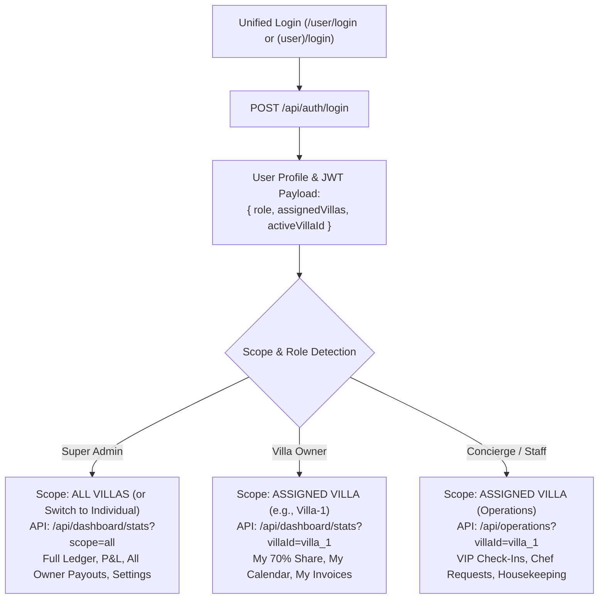

# LUXEESTATE DASHBOARD & RBAC ARCHITECTURE BLUEPRINT
## Unified Dashboard & Multi-Tenant Villa Scoping Rules (STRICT SPECIFICATION)

> **IMPORTANT ARCHITECTURAL RULE:**  
> Inside `(user)`, the **Login is COMMON** and the **Dashboard is COMMON**.  
> The system dynamically tailors API requests, metrics, ledgers, and sidebar menus depending on the authenticated user's role and assigned villa scope (All Villas vs. Individual Villa).

---

### 1. Core Architectural Concept



---

### 2. Role & Villa-Scope Hierarchy

| Role | Default Scope | Permitted Villas | Dashboard View | API Endpoint Parameters |
| :--- | :--- | :--- | :--- | :--- |
| **`SUPER_ADMIN`** | `'all'` | **All Platform Villas** | Global Top Cards (Combined Revenue MTD ₹12.45L), Master Profitability Ledger (All Villas), All Owner Payouts, System Settings. Can filter to any individual villa via Top Villa Switcher. | `GET /api/dashboard/stats?scope=all`<br>`GET /api/dashboard/ledger?scope=all` |
| **`VILLA_OWNER`** | Specific `villaId` | **Only Owned Villa(s)** (e.g. `villa_1`) | Owner Cards (My Villa Gross Revenue, Owner 70% Share, Maintenance Costs), Only My Villa Ledger & Guest Calendar. | `GET /api/dashboard/stats?villaId=villa_1`<br>`GET /api/dashboard/ledger?villaId=villa_1` |
| **`VILLA_MANAGER`** | Specific `villaId` | **Assigned Estate** | Daily VIP Check-ins / Check-outs, Chef Degustation Orders, Linen & Pool Maintenance, Quick Expense Logger. | `GET /api/operations?villaId=villa_1`<br>`POST /api/dashboard/expenses` |

---

### 3. API Contract & Auth Payload Structure

When a user logs in via `/api/auth/login`, the response payload **must strictly follow** this structure:

```json
{
  "success": true,
  "user": {
    "id": "usr_98234",
    "name": "Captain Sameer Mehta",
    "email": "owner@luxeestate.com",
    "role": "villa_owner",
    "assignedVillaId": "villa_3",
    "assignedVillas": [
      {
        "id": "villa_3",
        "name": "The Cloud Retreat, Lonavla"
      }
    ],
    "avatar": "https://images.unsplash.com/photo-1507003211169-0a1dd7228f2d?auto=format&fit=crop&w=200&q=80",
    "permissions": ["view_own_pnl", "view_own_calendar", "view_payout_slips"]
  },
  "token": "jwt_token_sample"
}
```

---

### 4. Dynamic Data Fetching Rules in Dashboard

1. **Top Metric Cards:**
   - If `activeVillaId === 'all'` (Super Admin): Displays platform-wide aggregates (`Total Revenue MTD`, `Total Expenses`, `Net Profit`, `Active Alerts`).
   - If `activeVillaId !== 'all'` (Individual Villa Owner / Filtered Admin): Displays scoped stats for that specific villa (`My Villa Revenue`, `Villa Expenses`, `Owner Net Share 70%`, `Pending Payout`).

2. **Villa Profitability & Expense Ledger Table:**
   - Super Admin: Displays all 9+ villa rows with full platform controls.
   - Villa Owner: Displays exclusively rows for their assigned villa(s) with monthly historical breakdown.

3. **Quick Expense Logger Form:**
   - Super Admin: Dropdown contains all villas.
   - Villa Owner / Manager: Pre-selected and locked to their assigned villa (`The Cloud Retreat, Lonavla`).

4. **Sidebar Dynamic Menus & Submenus:**
   - Controlled via `user.role` in `components/dashboard/layout/Sidebar.jsx`.
   - Expandable and collapsible submenus matching the user's operational clearance.

---

### 5. Preserved Directory Rules

1. **Routes:**
   - Public Website: `app/page.jsx`, `app/villas/`, `app/destinations/`, `app/contact/`, `app/login/` (Patron Login).
   - Internal Management: `app/(user)/` -> `/admin`, `/dashboard`, `/user/login`.
2. **Components:**
   - Isolated in `components/dashboard/` (`AdminButton`, `AdminInput`, `AdminSelect`, `AdminFileUpload`).
   - Layouts in `components/dashboard/layout/` (`Sidebar.jsx`, `Header.jsx`, `Footer.jsx`).
3. **State:**
   - Redux store tracks `user`, `isAuthenticated`, and `activeVillaId` in `redux/slices/authSlice.js`.
